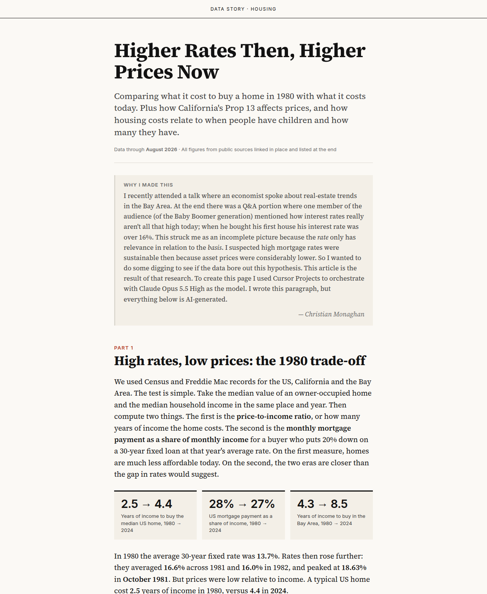
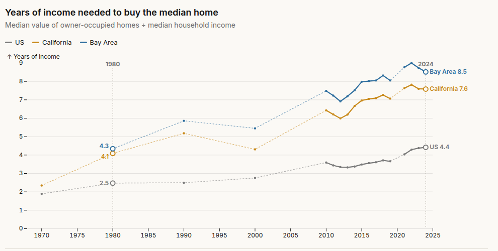
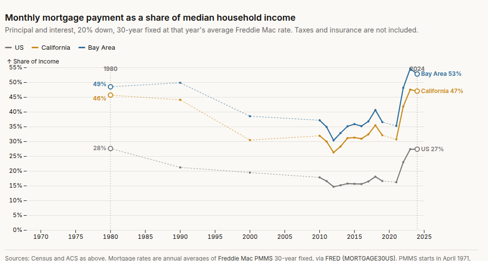

I recently attended a talk where an economist spoke about real-estate trends in the Bay Area. During the Q&A, one audience member mentioned that interest rates really aren't all that high today; when he bought his first house his interest rate was over 16%. This struck me as an incomplete picture, because the rate only matters relative to the price of the home. I suspected high mortgage rates were sustainable then because home prices were considerably lower relative to income, so I wanted to see if the data bore out this hypothesis.

The result is a data story titled "Higher Rates Then, Higher Prices Now." It compares price-to-income ratios and monthly mortgage payments across the US, California, and the Bay Area, and also looks at how California's Prop 13 affects prices and how housing costs relate to when people have children and how many they have.

I built this using Cursor Projects to orchestrate the work, with Claude Opus 5.5 High as the model.

*The intro to the data story*

*Years of income needed to buy the median home*

*Monthly mortgage payment as a share of median household income*
